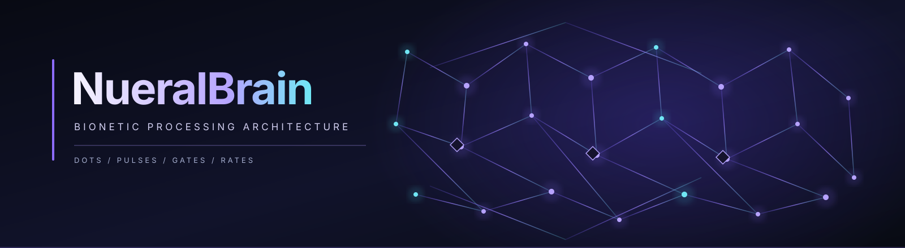

<p align="center">
  
</p>

<h1 align="center">NueralBrain</h1>

<p align="center">
  <strong>Bionetic processing architecture for neural-dot computing.</strong><br />
  Dots · Pulses · Gates · Rates · Structural Memory · Adaptive Pathways
</p>

<p align="center">
  <em>Research architecture and source blueprint — implementation status is documented honestly below.</em>
</p>

---

## Table of Contents

- [Overview](#overview)
- [Core Model](#core-model)
  - [The Five Primitives](#the-five-primitives)
  - [Seven Architectural Layers](#seven-architectural-layers)
  - [Corpus Topology](#corpus-topology)
- [Processing Cycle](#processing-cycle)
- [Systems Described in the Blueprint](#systems-described-in-the-blueprint)
- [Repository Contents](#repository-contents)
- [Implementation and Build Status](#implementation-and-build-status)
- [Build Screenshots](#build-screenshots)
- [Roadmap in the Source Blueprint](#roadmap-in-the-source-blueprint)
- [Source Document](#source-document)

---

## Overview

NueralBrain explores a biologically inspired computational substrate in which activity is modeled as communication between discrete, stateful units called **Dots**. Signals propagate as **Pulses**, routing is controlled by **Gates**, and **Rates** carry timing and signal metadata. The architecture proposes structural pathways, reinforcement, memory consolidation, and sleep/dream processing as mechanisms to investigate beyond conventional tensor-and-gradient-based model designs.

The central idea is that computation should be represented as activity and communication across a changing network of units—not presented as a conventional neural-network implementation.

> This repository preserves the supplied architecture and code sketches. It does not claim that the full system is implemented, biologically equivalent to a brain, or capable of general intelligence.

## Core Model

### The Five Primitives

| Primitive | Role in the architecture |
|---|---|
| **Dot** | Stateful computational cell with electrical state, chemical analogues, history, and connections. |
| **Pulse** | Signal carrying value, intensity, speed, type, payload, trace, and a hop limit. |
| **Gate** | Signal filter/router that can pass, block, modulate, or rate-limit activity. |
| **Rate** | Metadata grouping speed, seed, value, and intensity. |
| **Ending** | Incoming connection point representing the receiving side of a pathway. |

### Seven Architectural Layers

The source blueprint defines a seven-layer system, from the low-level substrate upward:

1. **Dot–Pulse Substrate** — unit state, firing, and pulse propagation.
2. **Gate Logic** — soft, hard, safe, value, rate, master, and trans gates.
3. **Bundle / Branch Routing** — organized pathways and inter-region communication.
4. **Neurochemical Simulation** — dopamine, serotonin, cortisol, acetylcholine, GABA, and glutamate analogues.
5. **Memory Architecture** — short-term storage and hippocampal-to-long-term consolidation.
6. **Reasoning Corpus** — clump formation, intent, meaning, and context resolution.
7. **Consciousness Loop** — awake, drowsy, dream, and deep-sleep states as proposed system modes.

These are architectural layers from the supplied design, not a statement that all seven are already working in code.

### Corpus Topology

The blueprint describes eight functional corpora:

- **Sensory** — receives external input.
- **Prefrontal** — executive processing, planning, and decisions.
- **Association** — central pattern integration and clump processing.
- **Hippocampus** — memory formation and recall gates.
- **Reward** — reinforcement and discipline signals.
- **Motor** — output/action patterns.
- **Long-Term Memory** — persistent structural storage.
- **Dream** — replay, reflection, and consolidation.

Inter-corpus communication is designed around bidirectional **trans-binary** channels, protected by safe gates.

## Processing Cycle

The proposed awake-state heartbeat is organized into ten stages:

1. Collect pending pulses.
2. Evaluate gates.
3. Integrate accepted signals into Dot state.
4. Decide whether Dots fire, subject to refractory state.
5. Propagate new pulses through branches.
6. Form and manage synchronous activity clumps.
7. Update chemical analogues and decay.
8. Apply structural plasticity.
9. Consolidate high-value memories.
10. Update fatigue and monitor runaway activity.

The complete specification and the original code sketches are retained in the [architecture source](docs/architecture/BIONETIC_PROCESSING_ARCHITECTURE.md).

## Systems Described in the Blueprint

The supplied document includes design and code sketches for:

- Dot, chemical-state, Ending, and Branch structures.
- Pulse types, payloads, traces, and time-to-live behavior.
- Gate types, conditions, transforms, and evaluation results.
- Rate scoring, decay, and reinforcement.
- Trans-binary channels and register/feed data.
- Corpus, Clump, and Bundle structures.
- A tick-driven processing engine.
- Dream, hippocampal memory, and reward/discipline subsystems.
- Text input/output encoding concepts.
- A proposed Rust-to-WASM/browser integration, service worker, and HTML visualization.

The document also contains explicit implementation placeholders. Those are preserved as unfinished work rather than silently filled in or represented as functioning features.

## Repository Contents

```text
NueralBrain/
├── README.md
├── assets/
│   └── nueralbrain-hero.svg
└── docs/
    └── architecture/
        └── BIONETIC_PROCESSING_ARCHITECTURE.md
```

## Implementation and Build Status

**Current repository state: architecture source captured; runnable implementation not yet verified.**

The supplied material is a long-form blueprint containing Rust, TOML, JavaScript, and HTML code blocks. It is not a complete Cargo workspace: the Cargo manifest appears inside the document, there is no crate source tree or test suite supplied alongside it, and some engine paths are explicitly marked as implementation work or placeholders.

For that reason, this initial commit does **not** invent a `cargo build` success, add substitute runtime code, or claim the proposed browser interface is operational. The next engineering step is to extract and implement the primitives as coherent Rust modules, close the documented gaps, then add deterministic tests and reproducible build instructions.

## Build Screenshots

No genuine build screenshots are available in the supplied source. Screenshots will be added here only after the actual project builds and runs; concept art, generated dashboards, and mock application screens are not presented as build evidence.

## Roadmap in the Source Blueprint

The original blueprint proposes these phases:

1. **Substrate** — Dot, Pulse, Gate, Rate, firing mechanics, and primitive tests.
2. **Connectivity** — branches/endings, trans-binary channels, bundles, and multi-corpus routing.
3. **Intelligence** — clumps, input/output encoding, chemical dynamics, reward/discipline.
4. **Memory** — short-term memory, hippocampal consolidation, value-gated long-term storage, and recall.
5. **Sleep** — dream processing, state transitions, replay, pruning, synthesis, and self-judgment.
6. **Plasticity** — Hebbian and reward-modulated learning, pruning, and neurogenesis.
7. **Web** — WASM, workers, persistence, frontend, and live visualization.
8. **Training** — feed data, reward outcomes, consolidate, observe, and iterate.

The phase descriptions and original estimates are preserved in the source document. Timelines and resource figures are design estimates, not measured benchmarks.

## Source Document

- [Bionetic Processing Architecture — complete supplied blueprint](docs/architecture/BIONETIC_PROCESSING_ARCHITECTURE.md)