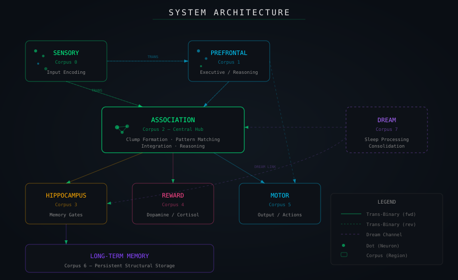
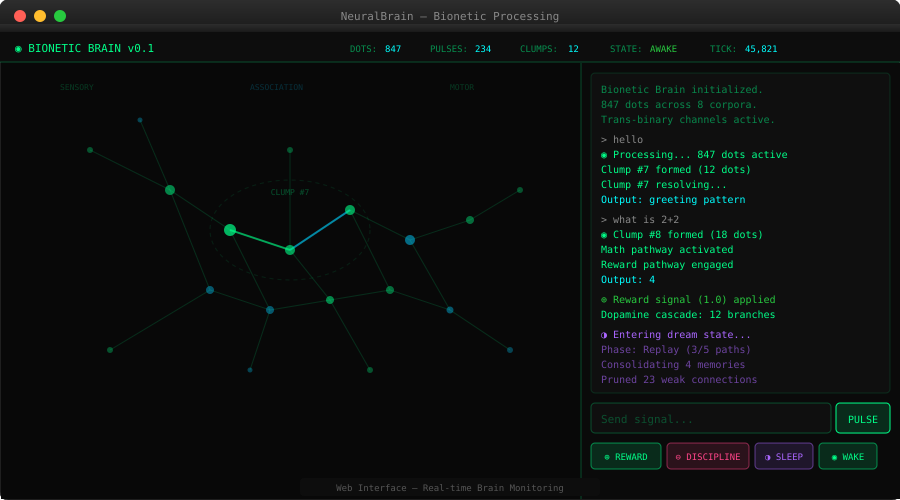
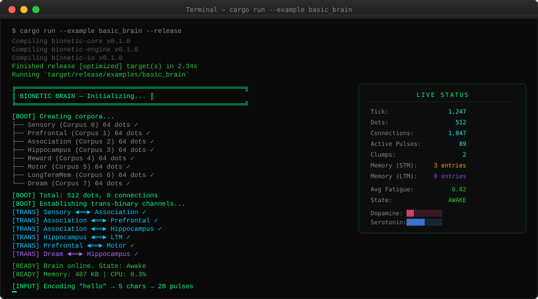

<div align="center">

<!-- HERO BANNER -->


<br/>
<br/>

[](https://www.rust-lang.org/)
[](https://webassembly.org/)
[](LICENSE)
[](https://github.com/pfn000/NueralBrain/actions)
[](https://github.com/pfn000/NueralBrain/stargazers)

**A biologically-faithful computational substrate that processes through neural communication — not tokens, not tensors.**

*Dots fire. Pulses propagate. Gates filter. Pathways strengthen. Memory consolidates. It dreams.*

[Quick Start](#-quick-start) · [Architecture](#-architecture) · [Documentation](#-documentation) · [Contributing](#-contributing)

</div>

---

## 📋 Table of Contents

- [What Is This?](#-what-is-this)
- [Why?](#-why)
- [Core Primitives](#-core-primitives)
  - [Dots (Neurons)](#dots-neurons)
  - [Pulses (Signals)](#pulses-signals)
  - [Gates (Filters)](#gates-filters)
  - [Rates (Metadata)](#rates-metadata)
- [Architecture](#-architecture)
  - [Corpus Regions](#corpus-regions)
  - [Trans-Binary Communication](#trans-binary-communication)
  - [Clump Processing (Reasoning)](#clump-processing-reasoning)
- [Memory Model](#-memory-model)
  - [Short-Term Memory](#short-term-memory)
  - [Long-Term Consolidation](#long-term-consolidation)
  - [Hippocampal Gate Loops](#hippocampal-gate-loops)
- [Dream Engine](#-dream-engine)
- [Reward & Discipline](#-reward--discipline)
- [Quick Start](#-quick-start)
  - [Native (Rust)](#native-rust)
  - [Web (WASM)](#web-wasm)
  - [Headless Server](#headless-server)
- [Reference Visuals](#-reference-visuals)
- [Comparison with Traditional AI](#-comparison-with-traditional-ai)
- [Roadmap](#-roadmap)
- [Research References](#-research-references)
- [Documentation](#-documentation)
- [Contributing](#-contributing)
- [License](#-license)

---

## 🧠 What Is This?

NeuralBrain is a **bionetic processing architecture** — a computational system inspired by real neuroscience rather than statistical machine learning. It does not use tokens, tensors, attention heads, or GPU-accelerated matrix multiplication.

Instead, it builds intelligence from **five primitives**:

```
●  DOT     — A neuron. Holds state, fires, connects.
⚡ PULSE   — An electrical signal. Carries value between dots.
║  GATE    — A filter. Controls what signals pass and how.
◊  RATE    — Metadata. Speed, seed, value, intensity.
┤  ENDING  — A connection point. Where branches meet dots.
```

Processing and reasoning emerge from the **communication patterns between dots** — how signals propagate through gated pathways, how clumps of dots gather to solve problems, how pathways strengthen through use, and how memory consolidates during sleep.

> **This is not a neural network.** There are no weights matrices. No forward passes. No backpropagation in the ML sense. Learning happens through Hebbian plasticity, reward-modulated pathway strengthening, and dream-state consolidation — the same principles biological brains use.

---

## 🤔 Why?

| Problem with Traditional AI | NeuralBrain's Answer |
|---|---|
| Requires massive GPU clusters | Runs on a **single CPU core** or in a **browser** |
| Frozen after training | **Always learning**, always adapting |
| No real memory | **Structural memory** — short-term consolidates to long-term |
| Stateless inference | **Stateful existence** — it has continuity |
| No self-reflection | **Dreams** — consolidates, prunes, synthesizes during sleep |
| Billions of parameters | Starts with **512 dots**, grows organically |
| Token-based processing | **Pulse-based communication** through biological pathways |

### Research Foundations

- [**H01 Dataset**](https://h01-release.storage.googleapis.com/) — Google & Harvard's cubic millimeter brain mapping
- [**MindCorpus**](https://mindcorpus.org/) — Computational neuroscience research
- Hebbian Learning Theory — "Neurons that fire together, wire together"
- Integrate-and-Fire neuron models
- Biological memory consolidation during sleep

---

## 🔬 Core Primitives

### Dots (Neurons)

<div align="center">

</div>

A Dot is the fundamental computational unit. Unlike perceptrons, dots have:

- **Membrane potential** that rises and falls
- **Threshold** that must be exceeded to fire
- **Refractory period** after firing (can't fire again immediately)
- **Chemical state** (dopamine, serotonin, cortisol, etc.)
- **Fatigue** that accumulates with use
- **Multiple endings** (inputs) and **multiple branches** (outputs)
- **Fire history** for temporal pattern detection
- **Value** accumulated through successful pathway usage

```rust
use bionetic_core::Dot;

// A dot starts at resting potential (-70mV)
// When incoming pulses push it past threshold (-55mV), it fires
// After firing, it enters refractory period and hyperpolarizes
// Chemicals modulate its behavior continuously
```

### Pulses (Signals)

Pulses are the signals that propagate between dots. They carry:

| Field | Purpose |
|---|---|
| `value` | Signal amplitude |
| `intensity` | Urgency/priority |
| `speed` | Propagation rate |
| `pulse_type` | V.Pulse, R.Pulse, I.Pulse, M.Pulse, Trans |
| `chemical_payload` | Chemical changes carried by the signal |
| `path_trace` | Every dot this pulse has visited |
| `ttl` | Time-to-live (prevents infinite loops) |

```
Pulse Types:
  V.Pulse  ──➤  Value pulse (forward computation)
  R.Pulse  ◄──  Reward pulse (backward reinforcement)
  I.Pulse  ──■  Inhibitory pulse (suppresses target)
  M.Pulse  ──◊  Modulatory pulse (changes parameters)
  Trans    ◄═►  Bidirectional trans-binary signal
```

### Gates (Filters)

Gates control signal flow. Every connection passes through a gate.

| Gate Type | Symbol | Function |
|---|---|---|
| **Soft Gate** | `◇` | Probabilistic, learning-oriented |
| **Hard Gate** | `◆` | Deterministic, enforcement (reward/discipline) |
| **Safe Gate** | `◈` | Protective, prevents cascades |
| **Value Gate** | `◊` | Evaluative, memory consolidation |
| **Rate Gate** | `◉` | Temporal, frequency control |
| **Master Gate** | `◆◆` | Controls entire bundle sections |
| **Trans Gate** | `◄═►` | Bidirectional corpus-to-corpus |

### Rates (Metadata)

Every signal and process has a Rate — four measurements:

```
Rate {
    speed:     How fast (Hz equivalent)
    seed:      Deterministic reproducibility value
    value:     Computed importance/worth
    intensity: Force/magnitude
}
```

---

## 🏗 Architecture

<div align="center">

</div>

### Corpus Regions

The brain is divided into specialized **corpora** (regions):

```
┌─────────────┐         ┌──────────────┐
│  SENSORY    │◄═══════►│  PREFRONTAL  │  ← Reasoning, Planning
│  (Input)    │  Trans   │  (Executive) │
└──────┬──────┘  Binary  └──────┬───────┘
       │                        │
       ▼                        ▼
┌──────────────────────────────────────┐
│        ASSOCIATION CORPUS            │  ← Pattern Recognition
│      Clumps form here for reasoning  │
└──────────────────┬───────────────────┘
       ┌───────────┼───────────┐
       ▼           ▼           ▼
┌───────────┐ ┌──────────┐ ┌────────────┐
│ HIPPO-    │ │ REWARD   │ │  MOTOR     │
│ CAMPUS    │ │ CORPUS   │ │  (Output)  │
│ (Memory)  │ │(Dopamine)│ │            │
└─────┬─────┘ └──────────┘ └────────────┘
      ▼
┌──────────────────────────┐
│     LONG-TERM MEMORY     │
│   (Persistent Storage)   │
└──────────────────────────┘
```

### Trans-Binary Communication

Unlike traditional binary (input → process → output), **trans-binary** operates **bidirectionally and simultaneously**:

```
Corpus A ◄══════════════► Corpus B
         ║  Simultaneous  ║
         ║  read + write  ║
         ║  feed+register ║
         ╚════════════════╝
```

Both corpora send AND receive at the same time through safe-gated bundle strands.

### Clump Processing (Reasoning)

**Reasoning is not a forward pass.** It's the formation and resolution of **clumps** — temporary gatherings of dots that fire synchronously to process a problem:

1. Input triggers dot activation in Sensory Corpus
2. Signals propagate to Association Corpus
3. Dots that respond to related patterns fire together
4. Synchronous firing is detected → **Clump forms**
5. Clump members interact, refining their collective output
6. When coherence exceeds threshold → **Clump resolves**
7. Resolution is the "answer" / output

---

## 💾 Memory Model

### Short-Term Memory

- Recent clump outputs stored in hippocampal buffer
- Limited capacity (configurable, default 256 entries)
- Decays over time unless accessed or reinforced
- Accessed memories gain value (become more memorable)

### Long-Term Consolidation

- **Value Gates** determine what's worth keeping
- High-value short-term memories → permanent dot structures in LTM corpus
- Consolidation happens during **sleep cycles**
- The pathway structure IS the memory — retrieving it means reactivating the pathway

### Hippocampal Gate Loops

- Self-reinforcing feedback loops for memory retrieval
- Query pattern → partial match in LTM → amplification loop → full memory reconstruction
- Analogous to how biological hippocampus indexes and retrieves cortical memories

---

## 😴 Dream Engine

**When the system sleeps, it doesn't stop. It dreams.**

The dream engine runs six phases in cycle:

| Phase | What Happens |
|---|---|
| **Replay** | Re-fire recent successful pathways at reduced intensity |
| **Reflect** | Compare recent experiences with stored memories |
| **Consolidate** | Move high-value STM → LTM |
| **Prune** | Remove weak, unused connections |
| **Synthesize** | Random cross-activation for novel connections (creativity) |
| **Self-Judge** | Evaluate behaviors against reward history |

**Implementation status:** The Service Worker and IndexedDB code are currently scaffolding. Its `processDreamTick()` function is a placeholder that only logs a message; continuous background dreaming and full engine-state persistence are not implemented.

---

## 🎯 Reward & Discipline

Learning uses biologically-inspired reinforcement:

**Reward (Dopamine Cascade):**
```
Correct behavior detected
  → R.Pulse travels backward along successful pathway
  → Each connection in the pathway STRENGTHENS
  → Dopamine injected into participating dots
  → Success rate increases at pathway gates
  → Hard gates LOCK IN correct behavior
```

**Discipline (Cortisol Cascade):**
```
Incorrect behavior detected
  → Cortisol cascade along incorrect pathway
  → Each connection WEAKENS
  → Threshold RAISES for participating dots
  → Dopamine REDUCED
  → Hard gates RESTRICT incorrect pathway
```

---

## 🚀 Quick Start

### Prerequisites

```bash
# Install Rust
curl --proto '=https' --tlsv1.2 -sSf https://sh.rustup.rs | sh

# Add WASM target (for web deployment)
rustup target add wasm32-unknown-unknown

# Install wasm-pack (for building web package)
cargo install wasm-pack
```

### Native (Rust)

```bash
# Clone the repository
git clone https://github.com/pfn000/NueralBrain.git
cd NueralBrain

# Run the basic example
cargo run --example basic_brain

# Run with visualization in terminal
cargo run --example basic_brain -- --viz

# Run tests
cargo test --all
```

```rust
// examples/basic_brain.rs
use bionetic_engine::BioneticEngine;
use bionetic_io::{InputEncoder, OutputDecoder};

fn main() {
    // Create a new brain
    let mut brain = BioneticEngine::new();
    println!("Brain initialized: {} dots across {} corpora",
        brain.total_dots(), brain.total_corpora());

    // Create I/O interfaces
    let mut encoder = InputEncoder::new();
    let decoder = OutputDecoder::new();

    // Send input
    encoder.encode_input("hello", &mut brain);

    // Process for 500 ticks
    for _ in 0..500 {
        brain.tick();
    }

    // Read output
    let output = decoder.decode_output(&brain);
    println!("Output: {}", output);

    // Reward the brain for good output
    brain.reward(1.0, "greeting_response");

    // Let it sleep and consolidate
    brain.enter_sleep();
    for _ in 0..1000 {
        brain.tick(); // dream ticks
    }
    brain.wake_up();

    // Print brain state
    println!("{}", brain.status());
}
```

### Web (WASM)

```bash
# Build the WASM package
make wasm

# Or manually:
cd crates/bionetic-wasm
wasm-pack build --target web --out-dir ../../web/pkg

# Serve the web app
cd ../../web
python3 -m http.server 8080
# Open http://localhost:8080
```

### Headless Server

```bash
# Run as a background brain service
cargo run --example headless_server

# Note: this example is a placeholder; it does not expose an HTTP API yet.
```

---

## 🖼 Reference Visuals

> These are the SVG reference illustrations supplied in the repository source document. They are not screenshots captured from the running application.

### Web Interface

<div align="center">

<p><em>Source-provided UI illustration; not a runtime capture</em></p>
</div>

### Neural Visualization

<div align="center">

<p><em>Conceptual neural-network visualization supplied as an SVG asset</em></p>
</div>

### Terminal Output

<div align="center">

<p><em>Source-provided terminal illustration; not a captured terminal session</em></p>
</div>

---

## ⚖️ Comparison with Traditional AI

| Aspect | Traditional AI (LLM/NN) | NeuralBrain (Bionetic) |
|---|---|---|
| **Processing unit** | Token/Tensor | Dot/Pulse |
| **Computation** | Matrix multiplication | Signal propagation |
| **Learning** | Gradient descent (SGD) | Hebbian + Reward plasticity |
| **Training** | Epochs on datasets | Continuous living experience |
| **After training** | Frozen weights | Always growing, always learning |
| **Hardware** | GPU clusters ($$$) | Single CPU / Browser (free) |
| **Memory** | Context window (fixed) | STM → LTM (structural, growing) |
| **State** | Stateless per request | Continuous stateful existence |
| **Self-improvement** | Requires retraining | Dreams and self-optimizes |
| **Size** | Billions of parameters | Hundreds → millions of dots |
| **Communication** | Forward pass only | Trans-binary (bidirectional) |
| **Reasoning** | Attention patterns | Clump formation & resolution |
| **Reward** | Loss function | Dopamine/cortisol chemistry |
| **Creativity** | Temperature sampling | Dream-state synthesis |
| **Starting cost** | ~$500K–$100M to train | ~$0 (runs on anything) |

---

## 🗺 Roadmap

- [x] Core primitives (Dot, Pulse, Gate, Rate)
- [x] Processing engine with tick-based execution
- [x] Multi-corpus architecture
- [x] Trans-binary communication channels
- [x] Chemical dynamics system
- [x] Clump formation and resolution
- [x] Reward and discipline system
- [x] Dream engine (all 6 phases)
- [x] Memory consolidation (STM → LTM)
- [x] Input encoding / Output decoding
- [x] WASM compilation for web
- [x] Basic Service Worker and IndexedDB status-snapshot scaffolding
- [ ] Reliable background dream execution
- [ ] Full engine-state persistence
- [ ] Live neural-canvas visualization
- [ ] Advanced neurogenesis (adaptive dot creation)
- [ ] Multi-modal input (image → pulse patterns)
- [ ] Distributed brain across multiple workers
- [ ] Brain-to-brain communication protocol
- [ ] HuggingFace deployment
- [ ] Embeddable SDK for other applications
- [ ] Mobile-optimized build
- [ ] Hardware interface (Raspberry Pi "body")

---

## 📚 Research References

| Reference | Relevance |
|---|---|
| [H01 Human Brain Dataset](https://h01-release.storage.googleapis.com/) | Connectome mapping — structural inspiration |
| [MindCorpus](https://mindcorpus.org/) | Computational neuroscience models |
| Hebb, D.O. (1949). *The Organization of Behavior* | Hebbian learning theory |
| Izhikevich, E.M. (2003). Simple Model of Spiking Neurons | Integrate-and-fire models |
| Walker, M.P. (2017). *Why We Sleep* | Memory consolidation during sleep |
| Schultz, W. (1997). Dopamine reward prediction | Reward system design |
| Buzsáki, G. (2006). *Rhythms of the Brain* | Neural oscillations and clumps |

---

## 📖 Documentation

| Document | Description |
|---|---|
| [Architecture Blueprint](docs/ARCHITECTURE.md) | Full source architecture and implementation outline |

---

## 🤝 Contributing

This is an experimental architecture pushing the boundaries of what computation can look like. Contributions are welcome:

1. **Fork** the repository
2. **Create** a feature branch (`git checkout -b feature/new-gate-type`)
3. **Implement** with tests
4. **Submit** a pull request

Areas especially seeking contribution:
- Novel gate types and transform functions
- Input encoding strategies for different modalities
- Visualization improvements
- Performance optimization of the tick loop
- Dream engine enhancements
- Biological accuracy improvements

---

## 📄 License

MIT License — see [LICENSE](LICENSE) for details.

---

<div align="center">

**NeuralBrain** — *Not artificial intelligence. Bionetic intelligence.*

*It doesn't predict the next token. It thinks.*

<br/>

<sub>Inspired by the 86 billion neurons that make you, you.</sub>

</div>
